# ScholarPal Database Schema & Entity-Relationship (ER) Diagram
*Team: TJH + KCS – ScholarPal Architecture & Data Modeling*

This document provides the PostgreSQL relational schema design, Entity-Relationship (ER) diagram, and constraint specifications for the **ScholarPal** platform.

---

## 1. Mermaid Entity-Relationship Diagram

```mermaid
erDiagram
    USERS ||--o| STUDENT_PROFILES : "has profile"
    USERS ||--o{ APPLICATIONS : "submits (Rule 8)"
    USERS ||--o{ REMINDERS : "receives"
    USERS ||--o{ NOTIFICATIONS : "receives"
    USERS ||--o{ AUDIT_LOG : "triggers as actor"
    USERS ||--o{ SCHOLARSHIP_VERSIONS : "approves as admin"

    SOURCES ||--o{ RETRIEVALS : "yields crawl runs"
    SOURCES ||--o{ RETRIEVAL_PROCESSING_CLAIMS : "claims atomic processing"
    SOURCES ||--o{ SCHOLARSHIPS : "supplies updates"

    RETRIEVALS ||--o{ SCHOLARSHIP_VERSIONS : "provides snapshot"
    RETRIEVALS ||--o{ EVIDENCE_CHECKS : "grounds evidence"

    SCHOLARSHIPS ||--o{ SCHOLARSHIP_VERSIONS : "versions across cycles"
    SCHOLARSHIPS ||--o{ APPLICATIONS : "applied to"

    SCHOLARSHIP_VERSIONS ||--o{ REQUIREMENTS : "defines deterministic rules"
    SCHOLARSHIP_VERSIONS ||--o{ REQUIRED_DOCUMENTS : "mandates checklists"
    SCHOLARSHIP_VERSIONS ||--o{ EVIDENCE_CHECKS : "evaluates (Rule 3)"

    REQUIREMENTS ||--o{ EVIDENCE_CHECKS : "verified by Jev"

    APPLICATIONS ||--o{ APPLICATION_TASKS : "contains action items"
    APPLICATIONS ||--o{ DOCUMENT_CHECKLIST_ITEMS : "tracks document uploads"
    APPLICATIONS ||--o{ INTERVIEWS : "schedules rounds"
    APPLICATIONS ||--o| AWARD_OFFERS : "results in offer"
    APPLICATIONS ||--o{ REMINDERS : "triggers reminders"

    REQUIRED_DOCUMENTS ||--o{ DOCUMENT_CHECKLIST_ITEMS : "fulfills requirement"
    APPLICATION_TASKS ||--o{ REMINDERS : "has due date alert"
    INTERVIEWS ||--o{ REMINDERS : "has calendar reminder"

    USERS {
        string id PK
        string email UK "Indexed"
        string hashed_password
        string full_name
        string role "student | administrator"
        boolean is_active
        datetime created_at
        datetime updated_at
    }

    STUDENT_PROFILES {
        string id PK
        string user_id FK,UK "Rule 8 ownership"
        string study_level "Secondary | Pre-U | Undergrad | Postgrad"
        string nationality "Malaysian | Non-Malaysian"
        string state_of_origin
        json academic_results "SPM, STPM, CGPA breakdown"
        float cgpa "Extracted numeric grade"
        string field_of_study "Current field"
        string intended_field "Intended major"
        float household_income "Rule 5: NULL when unknown, never 0"
        datetime created_at
        datetime updated_at
    }

    SOURCES {
        string id PK
        string name "Portal identifier"
        string base_url
        json config "Crawl delay, headers, selectors"
        string schedule "Cron expression"
        boolean is_active
        datetime last_retrieved_at
        datetime created_at
        datetime updated_at
    }

    RETRIEVALS {
        string id PK
        string source_id FK
        string url "Crawled endpoint"
        string status "success | failed | timeout | uncertain"
        integer http_status_code
        text error
        string content_hash "SHA-256 (history lookup index)"
        datetime retrieved_at
    }

    RETRIEVAL_PROCESSING_CLAIMS {
        string id PK
        string source_id FK
        string url
        string content_hash "UK on (source_id, url, content_hash)"
        datetime claimed_at
        datetime processed_at
    }

    SCHOLARSHIPS {
        string id PK
        string source_id FK
        string title "Official award name"
        string provider "Organizing body"
        string official_portal_url "Rule 7 submission portal"
        datetime deadline "Current cycle deadline"
        string status "open | closed | upcoming"
        string freshness "Rule 4: fresh | uncertain"
        datetime last_verified_at
        datetime created_at
        datetime updated_at
    }

    SCHOLARSHIP_VERSIONS {
        string id PK
        string scholarship_id FK
        string retrieval_id FK
        string application_cycle "e.g. 2026, Cycle 1"
        integer version_number "Revision counter"
        string title
        text description
        json coverage_details "Tuition, stipend, travel"
        datetime deadline
        string status "draft | pending | approved | rejected | deferred"
        json raw_extracted_data
        string approved_by FK "Administrator user"
        datetime approved_at
        datetime created_at
    }

    REQUIREMENTS {
        string id PK
        string scholarship_version_id FK
        string type "academic_cgpa | nationality | study_level | income"
        string operator "eq | gte | lte | in | contains"
        json value "Deterministic threshold value"
        boolean is_mandatory "Rule 2 mandatory flag"
        text source_excerpt "Verbatim portal citation"
        boolean is_subjective "Flag for human-reviewed criteria"
        datetime created_at
    }

    REQUIRED_DOCUMENTS {
        string id PK
        string scholarship_version_id FK
        string name "SPM Slip, IC Copy, Income Tax"
        text description
        boolean is_mandatory
        string format_instructions "e.g. Certified True Copy PDF"
        datetime created_at
    }

    EVIDENCE_CHECKS {
        string id PK
        string scholarship_version_id FK
        string requirement_id FK "Composite FK with version"
        string retrieval_id FK
        string jev_label "Supported | Refuted | Insufficient_Evidence"
        json probabilities "Distribution across choices"
        float confidence "0.0 - 1.0 confidence score"
        text evidence_excerpt "Citing source snippet"
        string admin_verdict "accepted | rejected | overridden"
        text admin_notes "Rule 3: Admin verification"
        datetime created_at
    }

    APPLICATIONS {
        string id PK
        string student_id FK "Rule 8 ownership"
        string scholarship_id FK
        string stage "Saved | Preparing | Submitted | Interview | Offered | Unsuccessful | Withdrawn"
        datetime submitted_at "Rule 7: Set on student confirmation"
        string submission_reference "Official provider slip ID"
        text notes
        datetime created_at
        datetime updated_at
    }

    APPLICATION_TASKS {
        string id PK
        string application_id FK
        string title
        text description
        string task_key "UK token: prevents duplicate tasks"
        boolean is_completed
        datetime due_date
        datetime completed_at
        datetime created_at
        datetime updated_at
    }

    DOCUMENT_CHECKLIST_ITEMS {
        string id PK
        string application_id FK
        string required_document_id FK "Validated slot integrity"
        string file_path "Stored file reference"
        string file_name
        boolean is_verified
        datetime uploaded_at
        text notes
        datetime created_at
        datetime updated_at
    }

    INTERVIEWS {
        string id PK
        string application_id FK
        string round_name "Screening | Panel | Assessment"
        datetime scheduled_at
        string location_or_url
        string format "in-person | virtual"
        string status "scheduled | completed | cancelled"
        text feedback_or_notes
        datetime created_at
        datetime updated_at
    }

    AWARD_OFFERS {
        string id PK
        string application_id FK,UK "1:1 with Application"
        float offer_amount
        string currency "MYR"
        json coverage_terms
        integer bond_duration_years
        datetime response_deadline
        string decision "pending | accepted | declined"
        datetime decision_date
        datetime created_at
        datetime updated_at
    }

    REMINDERS {
        string id PK
        string user_id FK
        string application_id FK
        string task_id FK
        string interview_id FK
        datetime remind_at
        string message
        boolean is_sent
        datetime sent_at
        datetime created_at
    }

    NOTIFICATIONS {
        string id PK
        string user_id FK
        string title
        text content
        string notification_type "general | deadline_warning | stage_update"
        string reference_url
        boolean is_read
        datetime read_at
        datetime created_at
    }

    AUDIT_LOG {
        string id PK
        string actor_id FK "Administrator or system actor"
        string action "version_approved | stage_changed | rule_modified"
        string entity_type "scholarship_version | application | requirement"
        string entity_id
        json changes "Before and after state diff"
        string ip_address
        datetime timestamp
    }
```

---

## 2. Table Specifications & Architectural Compliance

### 2.1. Invariant Rules Alignment
- **Rule 1 (Deterministic Eligibility)**: Stored in `requirements` table with strict typed operators (`eq`, `gte`, `lte`, `in`, `contains`) and values. Evaluated purely by deterministic code, never by LLM output.
- **Rule 2 (Three-State Requirement Evaluation)**: Each row in `requirements` carries `is_mandatory`. If any mandatory row evaluates as `unmet`, the overall verdict is *Does not meet recorded requirements*. If no mandatory row is unmet but any row is `unresolved`, the verdict is *Needs clarification*.
- **Rule 3 (Jev Evidence Checks Never Auto-Publish)**: `evidence_checks` records store the Jev `Choice` primitive (`Supported`, `Refuted`, `Insufficient_Evidence`), probability distributions, and confidence metrics. The associated `scholarship_versions` status remains `draft` or `pending` until an administrator records `admin_verdict` and signs off (`approved_by`).
- **Rule 4 (Freshness Preservation on Retrieval Failure)**: When a crawl retrieval fails (`retrievals.status = "failed"`), the `scholarships.freshness` flag is updated to `"uncertain"`, leaving `status = "open"` and retaining the last approved `scholarship_versions`.
- **Rule 5 (Unknown Values Remain NULL)**: `student_profiles.household_income` is a nullable float and defaults to `NULL`, never `0.0`.
- **Rule 7 (External Portal Submission)**: `applications.stage` transitions to `Submitted` only upon verified student input; ScholarPal stores `submission_reference` and `submitted_at`, and never marks submission automatically.
- **Rule 8 (Student Record Ownership Enforcement)**: `applications`, `student_profiles`, `reminders`, and `notifications` enforce foreign keys directly to `users.id` with dedicated database indexes for sub-millisecond tenant authorization checks.

---

## 3. Uniqueness Constraints & Idempotency Controls

To ensure high data integrity, prevent race conditions, and guarantee idempotent job execution, the schema defines the following constraints:

| Table | Constraint / Index Name | Columns | Purpose |
| :--- | :--- | :--- | :--- |
| `application_tasks` | `uq_application_tasks_app_key` | `(application_id, task_key)` | **Prevents duplicate task generation** for the same application action item. |
| `retrieval_processing_claims` | `uq_retrieval_processing_claims` | `(source_id, url, content_hash)` | **Atomic claim deduplication** ensuring identical content hashes are not re-processed at the boundary. |
| `retrievals` | `ix_retrievals_source_url_hash` | `(source_id, url, content_hash)` | **Non-unique lookup index** across historical crawl runs (does not enforce deduplication). |
| `scholarship_versions` | `uq_scholarship_cycle_version` | `(scholarship_id, application_cycle, version_number)` | Enforces **unique cycle revision counters**. Snapshot immutability for approved versions is enforced by the `before_update` listener. |
| `applications` | `uq_applications_active_student_scholarship` | `(student_id, scholarship_id)` WHERE stage != 'Withdrawn' | **Partial unique index** restricting students to one active application while permitting re-application after withdrawal. |
| `document_checklist_items` | `uq_doc_checklist_app_doc` | `(application_id, required_document_id)` | Prevents duplicate checklist slots for the same required document. Validated on write to ensure document matches application scholarship. |
| `evidence_checks` | `uq_evidence_checks_version_req` | `(scholarship_version_id, requirement_id)` | Guarantees **one evidence check per requirement per version revision**. Composite FK enforces version alignment. |
| `requirements` | `uq_requirements_version_id` | `(scholarship_version_id, id)` | Enables composite foreign key targeting from `evidence_checks`. |
| `award_offers` | `ix_award_offers_application_id` | `(application_id)` | Enforces a strict 1:1 relationship between application and award offer via a unique index. |
| `student_profiles` | `ix_student_profiles_user_id` | `(user_id)` | Enforces a strict 1:1 relationship between user and student profile. |
| `users` | `ix_users_email` | `(email)` | Enforces unique email addresses across students and administrators. |

---

## 4. Migration History

Migrations are managed with Alembic in `backend/alembic/versions/`:
- `0001_initial_schema.py`: Initial prototype baseline schema.
- `0002_rich_schema.py`: Complete enterprise schema upgrade introducing `users`, `sources`, `retrievals`, `retrieval_processing_claims`, `scholarship_versions`, `requirements`, `required_documents`, `evidence_checks`, `applications`, `application_tasks`, `document_checklist_items`, `interviews`, `award_offers`, `reminders`, `notifications`, and `audit_log` with verified user backfilling, legacy application migration, cascading foreign keys, and unique constraints.
